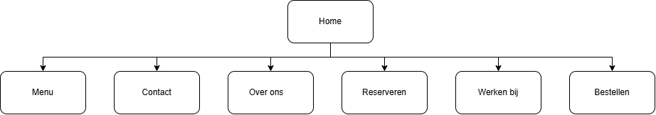
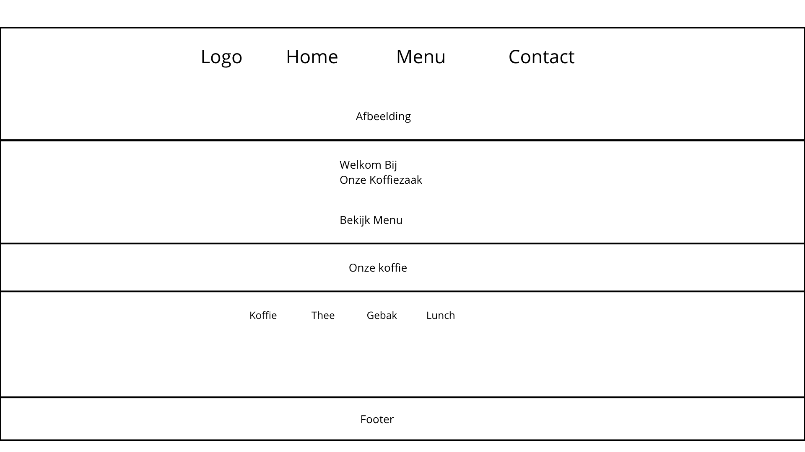
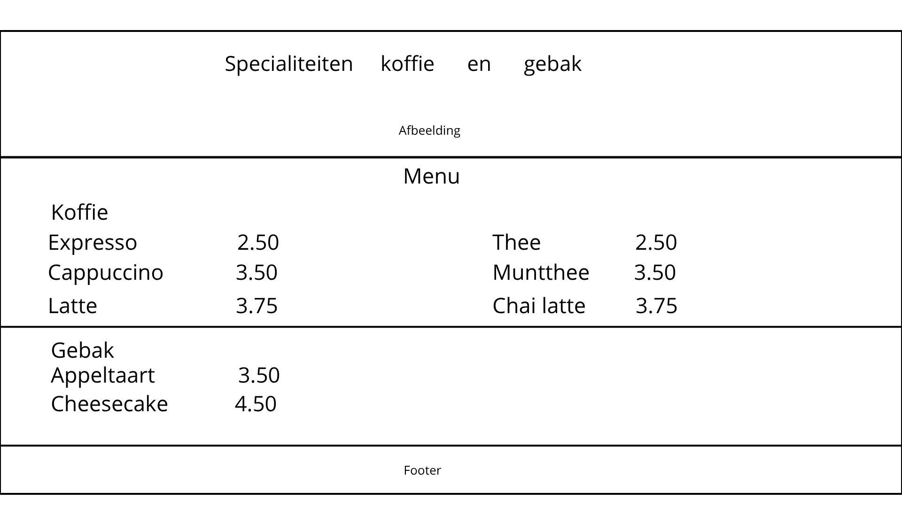

# Cozy Brew – Functioneel Ontwerp

☕

Deel 1 \| Teamproject Koffiezaak

━━━━━━━━━━━━━━━━━━━━

Een warme plek voor koffie, thee en gebak

<table>
<colgroup>
<col style="width: 50%" />
<col style="width: 50%" />
</colgroup>
<thead>
<tr class="header">
<th><strong>Project</strong></th>
<th>Cozy Brew</th>
</tr>
</thead>
<tbody>
<tr class="odd">
<td><strong>Teamleden</strong></td>
<td>
Debora Rodriguez Montaldo

Mitchell vd Linden

Koen van der Wouw

Yannick Veldhuisen

Matthieu Hoogesteger

Cheyenne Trommelen
</td>
</tr>
<tr class="even">
<td><strong>Opleiding / klas</strong></td>
<td>DT-FDD-02</td>
</tr>
<tr class="odd">
<td><strong>Datum / versie</strong></td>
<td>19-10-2026 | Versie 0.1</td>
</tr>
</tbody>
</table>

Avans • Projectdocumentatie

# 1. Inleiding

Cozy Brew is een website voor een koffiezaak waar bezoekers informatie kunnen vinden over het assortiment koffie, thee en gebak. De website heeft als doel het aanbod en de bijbehorende prijzen op een duidelijke en overzichtelijke manier te presenteren.

In dit functioneel ontwerp beschrijven we het doel van de website, de doelgroep, de belangrijkste gebruikerswensen en de gewenste werking van de verschillende pagina’s. Daarnaast leggen we de functionele eisen, gebruikersroutes en ontwerpkeuzes vast.

Dit document wordt tijdens de ontwikkeling van het project bijgewerkt wanneer de wensen, functionaliteit of ontwerpen veranderen.

## 1.1 Doel van de website

Het doel van de Cozy Brew-website is om bezoekers op een duidelijke en toegankelijke manier te informeren over de koffiezaak en haar assortiment.

Via de website kunnen bezoekers het aanbod van koffie, thee en gebak bekijken, inclusief de bijbehorende prijzen. Door een overzichtelijke navigatie en een aantrekkelijke vormgeving kunnen bezoekers eenvoudig de gewenste informatie vinden.

De website ondersteunt hiermee de online presentatie van Cozy Brew en helpt potentiële klanten om kennis te maken met de koffiezaak.

## 1.2 Doelgroep

De Cozy Brew-website richt zich op mensen die graag koffie of thee drinken en op zoek zijn naar een gezellige koffiezaak met een gevarieerd assortiment.

De doelgroep bestaat onder andere uit bezoekers die vooraf het aanbod en de prijzen willen bekijken. Zij hebben behoefte aan duidelijke informatie, eenvoudige navigatie en een overzichtelijke presentatie van de producten.

Om de wensen en behoeften van de doelgroep beter in kaart te brengen, heeft het projectteam twee persona’s opgesteld: Erik Pieterson en Sophie van Dijk. Deze persona’s worden gebruikt als uitgangspunt bij het ontwerpen van een gebruiksvriendelijke website.

## 1.3 Afbakening van het product 

De Cozy Brew-website richt zich op de ontwikkeling van een overzichtelijke en gebruiksvriendelijke website voor een koffiezaak.

Binnen het project vallen de presentatie van het assortiment koffie, thee en overige dranken en gebak, de bijbehorende productinformatie en prijzen, en de navigatie tussen de verschillende webpagina’s.

De huidige groepsversie bevat onder andere pagina’s voor het menu, contact, reserveringen, informatie over de koffiezaak en werken bij Cozy Brew. Ook worden interactieve functies met JavaScript ontwikkeld.

Een online bestelsysteem met winkelmandje is gepland als uitbreiding van de Cozy Brew-website en zal in een volgende ontwikkelingsfase worden toegevoegd. Hiermee kunnen bezoekers producten selecteren en aan hun winkelmandje toevoegen. De precieze werking en eventuele aanvullende functionaliteiten worden tijdens de verdere ontwikkeling door het projectteam vastgesteld en gedocumenteerd.

# 2. Requirements

Voor het prioriteren van de requirements van Cozy Brew wordt de MoSCoW-methode gebruikt. Deze methode verdeelt de eisen in vier categorieën: Must Have, Should Have, Could Have en Won’t Have. Hiermee kan het projectteam bepalen welke functionaliteiten noodzakelijk zijn en welke eventueel later kunnen worden (Wikipedia-bijdragers, 2026).

## 2.1 Functionele requirements

| ID    | Functionele requirement                                                                                                                                                                                                                                                                                           | Prioriteit  | Acceptatiecriterium                                                                                                                                                                                                                                                                            |
|-------|-------------------------------------------------------------------------------------------------------------------------------------------------------------------------------------------------------------------------------------------------------------------------------------------------------------------|-------------|------------------------------------------------------------------------------------------------------------------------------------------------------------------------------------------------------------------------------------------------------------------------------------------------|
| FR-01 | Menu bekijken                                                                                                                                                                                                                                                                                                     | Must Have   | Producten en prijzen zichtbaar                                                                                                                                                                                                                                                                 |
| FR-02 | De bezoeker kan via het navigatiemenu naar de verschillende pagina’s van de website gaan                                                                                                                                                                                                                          | Must Have   | Bij het aanklikken van een navigatielink wordt de juiste pagina geopend                                                                                                                                                                                                                        |
| FR-03 | De bezoeker kan de contactpagina van Cozy Brew bekijken om contactinformatie te vinden                                                                                                                                                                                                                            | Must Have   | De contactpagina is bereikbaar via de navigatie en toont de beschikbare contactinformatie                                                                                                                                                                                                      |
| FR-04 | De bezoeker moet producten aan het winkelmandje kunnen toevoegen, aantallen wijzigen en producten verwijderen. Voordat de bestelling definitief wordt bevestigd, moet de bezoeker de ingevulde persoonsgegevens, geselecteerde producten, aantallen en het totaalbedrag kunnen controleren en zo nodig aanpassen. | Must Have   | De bezoeker kan producten toevoegen, wijzigen en verwijderen. Het totaalbedrag wordt na iedere wijziging correct herberekend. Vóór de definitieve bevestiging krijgt de bezoeker een overzicht van de bestelling en de ingevulde persoonsgegevens, met de mogelijkheid om fouten te corrigeren |
| FR-05 | De bezoeker kan de reserveringspagina openen en de beschikbare reserveringsmogelijkheden bekijken                                                                                                                                                                                                                 | Should Have | De reserveringspagina is bereikbaar en toont de beschikbare informatie of invoervelden voor een reservering                                                                                                                                                                                    |
| FR-06 | De bezoeker kan informatie over Cozy Brew en de koffiezaak bekijken                                                                                                                                                                                                                                               | Should Have | De informatiepagina is bereikbaar via de website en toont een beschrijving van Cozy Brew                                                                                                                                                                                                       |
| FR-07 | De bezoeker kan de pagina “Werken bij Cozy Brew” openen en informatie over werken bij de koffiezaak bekijken                                                                                                                                                                                                      | Could Have  | De pagina is bereikbaar via de website en toont de beschikbare informatie over werken bij Cozy Brew                                                                                                                                                                                            |

## 2.2 Niet-functionele requirements

Niet-functionele requirements beschrijven aan welke kwaliteitseisen de website van Cozy Brew moet voldoen. Hierbij gaat het bijvoorbeeld om gebruiksvriendelijkheid, toegankelijkheid, prestaties en veiligheid. Deze eisen zorgen ervoor dat de website niet alleen goed functioneert, maar ook prettig, betrouwbaar en veilig te gebruiken is.

| ID     | Niet-functionele requirements                                                                            | Prioriteit  | Acceptatiecriterium                                                                                                            |
|--------|----------------------------------------------------------------------------------------------------------|-------------|--------------------------------------------------------------------------------------------------------------------------------|
| NFR-01 | De website moet eenvoudig en overzichtelijk te gebruiken zijn                                            | Must Have   | Een gebruiker kan vanaf de homepage binnen maximaal drie klikken de menupagina bereiken                                        |
| NFR-02 | De website moet zich aanpassen aan verschillende schermformaten, zoals computers, tablets en smartphones | Must Have   | Bij schermbreedtes van 375 px, 768 px en 1440 px blijft de inhoud leesbaar en bruikbaar, zonder horizontaal te hoeven scrollen |
| NFR-03 | De website moet toegankelijk zijn voor gebruikers die met een toetsenbord navigeren                      | Should Have | Alle navigatielinks en knoppen zijn bereikbaar en bedienbaar met de Tab- en Enter-toetsen                                      |
| NFR-04 | De website moet pagina’s binnen een redelijke tijd laden                                                 | Should Have | De homepage en menupagina laden binnen maximaal 3 seconden bij een gesimuleerde snelle 4G-verbinding                           |
| NFR-05 | De website moet gebruikersinvoer veilig verwerken en beschermen tegen ongewenste scripts                 | Must Have   | Invoer van gebruikers wordt als tekst weergegeven en niet als uitvoerbare HTML of JavaScript                                   |

# 3. Gebruikersroutes en usecases

In dit hoofdstuk worden de belangrijkste gebruikersroutes en usecases van de Cozy Brew-website beschreven. Een gebruikersroute laat zien welke stappen een bezoeker doorloopt om een bepaald doel te bereiken. Een usecase beschrijft hoe een gebruiker met de website communiceert om een specifieke handeling uit te voeren.

Deze beschrijvingen helpen het projectteam om de website logisch, overzichtelijk en gebruiksvriendelijk te ontwerpen.

## 3.1 Gebruikersroute: Het menu bekijken

Doel: De bezoeker wil bekijken welke koffie, thee en gebakjes Cozy Brew aanbiedt en wat deze producten kosten.

Gebruikersroute:

1.  De bezoeker opent de homepage van Cozy Brew.

2.  De bezoeker klikt in het navigatiemenu op “Menu”.

3.  De website opent de menupagina.

4.  De bezoeker bekijkt de beschikbare koffie, thee en gebakjes met de bijbehorende prijzen.

Verwacht resultaat: De bezoeker kan het assortiment en de prijzen bekijken zonder eerst een account aan te maken of een bestelling te plaatsen.

## 3.2 Gebruikersroute: Contactinformatie vinden

Doel: De bezoeker wil de contactgegevens van Cozy Brew vinden om contact op te kunnen nemen met de koffiezaak.

Gebruikersroute:

1.  De bezoeker opent de homepage van Cozy Brew.

2.  De bezoeker klikt in het navigatiemenu op “Contact”.

3.  De website opent de contactpagina.

4.  De bezoeker bekijkt de beschikbare contactinformatie.

Verwacht resultaat: De bezoeker kan de contactgegevens van Cozy Brew eenvoudig vinden, zonder daarvoor andere pagina’s te hoeven doorzoeken.

## 3.3 Gebruikersroute: Een reservering maken

Doel: De bezoeker wil via de website van Cozy Brew een tafel reserveren.

Gebruikersroute:

1.  De bezoeker opent de homepage van Cozy Brew.

2.  De bezoeker klikt in het navigatiemenu op “Reserveren”.

3.  De website opent de reserveringspagina.

4.  De bezoeker vult de gevraagde reserveringsgegevens in.

5.  De bezoeker controleert de gegevens en verstuurt het formulier.

Verwacht resultaat: De bezoeker kan het reserveringsformulier invullen en verzenden. De website geeft duidelijk aan of het formulier correct is verwerkt.

## 3.4 Gebruikersroute: Producten bestellen 

Doel: De bezoeker wil via de website van Cozy Brew producten selecteren en een bestelling samenstellen.

Gebruikersroute:

1.  De bezoeker opent de website van Cozy Brew.

2.  De bezoeker gaat naar de bestelpagina.

3.  De bezoeker selecteert een product en vult het gewenste aantal in.

4.  De bezoeker voegt het product toe aan het winkelmandje.

5.  De website toont de geselecteerde producten en berekent het totaalbedrag.

6.  De bezoeker kan de bestelling aanpassen door de aantallen te wijzigen of producten uit het winkelmandje te verwijderen.

7.  De website berekent na iedere wijziging opnieuw het totaalbedrag.

8.  De bezoeker controleert de ingevulde persoonsgegevens, geselecteerde producten, aantallen en het totaalbedrag. Eventuele fouten kunnen vóór de definitieve bevestiging worden aangepast.

9.  Nadat de bezoeker alle gegevens heeft gecontroleerd, bevestigt deze de bestelling.

Verwacht resultaat: De bezoeker kan meerdere producten aan het winkelmandje toevoegen, toevoegen, aantallen aanpassen, het totaalbedrag bekijken, de persoonsgegevens en bestelling controleren en de bestelling bevestigen.

## 3.5 Usecases

### UC-01: Menu bekijken

| **Onderdeel**        | **Beschrijving**                                                                                                |
|----------------------|-----------------------------------------------------------------------------------------------------------------|
| Usecase-ID           | UC-01                                                                                                           |
| Naam                 | Menu bekijken                                                                                                   |
| Actor                | Bezoeker van de website                                                                                         |
| Doel                 | Het assortiment koffie, thee en gebak met bijbehorende prijzen bekijken                                         |
| Voorwaarde           | De bezoeker heeft de Cozy Brew-website geopend                                                                  |
| Hoofdscenario        | 1\. De bezoeker klikt op “Menu”. 2. De website opent de menupagina. 3. De website toont de producten en prijzen |
| Alternatief scenario | Als de menupagina niet geladen kan worden, kan de bezoeker het assortiment niet bekijken                        |
| Resultaat            | De bezoeker kan het assortiment van Cozy Brew en de bijbehorende prijzen bekijken                               |

### UC-02: Contactinformatie vinden

| **Onderdeel**        | **Beschrijving**                                                                                                                                    |
|----------------------|-----------------------------------------------------------------------------------------------------------------------------------------------------|
| Usecase-ID           | UC-02                                                                                                                                               |
| Naam                 | Contactinformatie vinden                                                                                                                            |
| Actor                | Bezoeker van de website                                                                                                                             |
| Doel                 | De contactgegevens van Cozy Brew vinden om contact te kunnen opnemen met de koffiezaak                                                              |
| Voorwaarde           | De bezoeker heeft de Cozy Brew-website geopend                                                                                                      |
| Hoofdscenario        | 1\. De bezoeker klikt op “Contact” in het navigatiemenu. 2. De website opent de contactpagina. 3. De website toont de beschikbare contactinformatie |
| Alternatief scenario | Als de contactpagina niet geladen kan worden, kan de bezoeker de contactinformatie via deze pagina niet bekijken                                    |
| Resultaat            | De bezoeker kan de beschikbare contactgegevens van Cozy Brew bekijken                                                                               |

### UC-03: Een tafel reserveren

| **Onderdeel**        | **Beschrijving**                                                                                                                                                                                                                                  |
|----------------------|---------------------------------------------------------------------------------------------------------------------------------------------------------------------------------------------------------------------------------------------------|
| Usecase-ID           | UC-03                                                                                                                                                                                                                                             |
| Naam                 | Een tafel reserveren                                                                                                                                                                                                                              |
| Actor                | Bezoeker van de website                                                                                                                                                                                                                           |
| Doel                 | Een tafel bij Cozy Brew reserveren via de website                                                                                                                                                                                                 |
| Voorwaarde           | De bezoeker heeft de Cozy Brew-website geopend en kan de reserveringspagina bekijken                                                                                                                                                              |
| Hoofdscenario        | 1\. De bezoeker klikt op “Reserveren”. 2. De website opent de reserveringspagina. 3. De bezoeker vult de gevraagde gegevens in. 4. De bezoeker verstuurt het formulier. 5. De website verwerkt de invoer en toont een melding over het resultaat. |
| Alternatief scenario | Als verplichte gegevens ontbreken of ongeldig zijn, krijgt de bezoeker een melding en kan deze de gegevens corrigeren                                                                                                                             |
| Resultaat            | De bezoeker heeft het reserveringsformulier ingevuld en verzonden en krijgt duidelijkheid over de verwerking ervan                                                                                                                                |

### UC-04: Producten bestellen en bestelling controleren

| Onderdeel            | Beschrijving                                                                                                                                                                                                                                                                                                                                                                                                                                                                            |
|----------------------|-----------------------------------------------------------------------------------------------------------------------------------------------------------------------------------------------------------------------------------------------------------------------------------------------------------------------------------------------------------------------------------------------------------------------------------------------------------------------------------------|
| Usecase-ID           | UC-04                                                                                                                                                                                                                                                                                                                                                                                                                                                                                   |
| Naam                 | Producten bestellen en bestellingen controleren                                                                                                                                                                                                                                                                                                                                                                                                                                         |
| Actor                | Bezoeker van de website                                                                                                                                                                                                                                                                                                                                                                                                                                                                 |
| Doel                 | Producten bestellen en alle gegevens controleren vóór de definitieve bevestiging                                                                                                                                                                                                                                                                                                                                                                                                        |
| Voorwaarde           | De bezoeker heeft de bestelpagina geopend                                                                                                                                                                                                                                                                                                                                                                                                                                               |
| Hoofdscenario        | 1\. De bezoeker selecteert producten en aantallen. 2-De bezoeker voegt producten toe aan het winkelmandje. 3. De website berekent het totaalbedrag. 4. De bezoeker kan aantallen wijzingen of producten verwijderen. 5. De website herberekent het totaalbedrag. 6. De bezoeker vult de persoonsgegevens in. 7. De website toont een overzicht van de bestelling en persoonsgegevens. 8. De bezoeker controleert en corrigeert eventuele fouten. 9. De bezoeker bevestigt de bestelling |
| Alternatief scenario | Als verplichte gegevens ontbreken, aantallen ongeldig zijn of het winkelmandje leeg is, kan de bezoeker de bestelling niet bevestigen en krijgt deze een duidelijke melding                                                                                                                                                                                                                                                                                                             |
| Resultaat            | De bezoeker kan een bestelling samenstellen, aanpassen, controleren en bevestigen                                                                                                                                                                                                                                                                                                                                                                                                       |

# 4. Sitemap en navigatiestructuur

De sitemap geeft een overzicht van de paginastructuur van de Cozy Brew-website. De homepage vormt het centrale startpunt van waaruit bezoekers via het navigatiemenu naar de verschillende pagina’s kunnen gaan.

De website bestaat uit de pagina’s Home, Menu, Contact, Over ons, Reserveren, Werken bij en Bestellen. Deze structuur zorgt ervoor dat de bezoekers eenvoudig kunnen navigeren en de gewenste informatie of functionaliteit kunnen vinden.

# 5. Wireframes en schermontwerp

Tijdens de beginfase van het Cozy Brew-project zijn wireframes opgesteld om de globale indeling van de website te bepalen. Deze schematische ontwerpen geven inzicht in de plaatsing van de navigatie, afbeeldingen, teksten, productinformatie en footer.

De oorspronkelijke wireframes zijn gemaakt voor de homepage en de menupagina. Tijdens de verdere ontwikkeling is de website uitgebreid met extra pagina’s en functionaliteiten. Hierdoor kan de huidige uitvoering op onderdelen afwijken van de eerste ontwerpen.

## 5.1 Wireframe homepage

Het oorspronkelijke wireframe van de homepage toont de globale indeling van de Cozy Brew-website. Bovenaan bevinden zich het logo en het navigatiemenu. Daaronder is ruimte voor een afbeelding en een welkomsttekst die bezoekers kennis laat maken met de koffiezaak.

Verder bevat het ontwerp een overzicht van het assortiment, waaronder koffie, thee, gebak en lunch. Onderaan is een footer opgenomen.

Dit wireframe diende als uitgangspunt voor de eerste ontwikkeling van de homepage. Tijdens het project is de website verder uitgebreid en aangepast.

## 5.2 Wireframe menupagina

Het oorspronkelijke wireframe van de menupagina toont de globale indeling van het assortiment van Cozy Brew. Bovenaan is ruimte gereserveerd voor een titel en een afbeelding.

Daaronder bevindt zich een overzicht van de verschillende producten, waaronder koffie, thee en gebak, met de bijbehorende prijzen. Onderaan de pagina is een footer opgenomen.

Dit wireframe vormde het uitgangspunt voor de ontwikkeling van de menupagina. Tijdens de verdere ontwikkeling zijn de vormgeving en presentatie van de producten aangepast en uitgebreid.

# 6. Functionele beschrijving van de pagina's

> In dit hoofdstuk worden de belangrijkste functies van de verschillende pagina’s van de Cozy Brew-website beschreven. Per pagina wordt toegelicht welke informatie beschikbaar is en welke handelingen een bezoeker kan uitvoeren.
>
> De functionele beschrijving vormt een aanvulling op de requirements en gebruikersroutes uit de voorgaande hoofdstukken. Hierbij ligt de nadruk op de werking van de website vanuit het perspectief van de bezoeker.

## 6.1 Homepage

> De homepage is het centrale startpunt van de Cozy Brew-website. Op deze pagina maken bezoekers kennis met de koffiezaak en krijgen zij een eerste indruk van het assortiment en de uitstraling van Cozy Brew.
>
> Via het navigatiemenu kunnen bezoekers naar verschillende onderdelen van de website gaan, waaronder het menu, de contactpagina, informatie over de koffiezaak, reserveringen, werken bij Cozy Brew en de bestelpagina.
>
> De homepage heeft als belangrijkste functie bezoekers te informeren en hen op een eenvoudige en overzichtelijke manier naar de gewenste pagina te begeleiden.

## 6.2 Menupagina

De menupagina geeft bezoekers een overzicht van het assortiment van Cozy Brew. De producten zijn onderverdeeld in verschillende categorieën, waaronder koffie, thee en gebak.

Bij de producten worden de bijbehorende prijzen weergegeven, zodat bezoekers eenvoudig het aanbod kunnen bekijken en vergelijken.

De belangrijkste functie van de pagina is het duidelijk presenteren van het assortiment en de prijzen, zonder dat de bezoekers hiervoor een account hoeven aan te maken of een bestelling hoeven te plaatsen.

## 6.3 Contactpagina

De contactpagina biedt bezoekers de mogelijkheid om contact op te nemen met Cozy Brew. Op deze pagina vinden de bezoekers de contactgegevens van de koffiezaak en kunnen zij een bericht versturen via het contactformulier.

Via het contactformulier kunnen bezoekers hun gegevens en een bericht invullen. Hiermee kunnen zij bijvoorbeeld vragen stellen of opmerkingen doorgeven.

De belangrijkste functie van deze pagina is het toegankelijk maken van de communicatie tussen bezoekers en Cozy Brew.

## 6.4 Over ons

De pagina “Over ons” geeft de bezoekers informatie over Cozy Brew en de achtergrond van de koffiezaak. Op deze pagina maken bezoekers kennis met het concept, de sfeer en de identiteit van Cozy Brew.

De informatie helpt bezoekers om een beter beeld te krijgen van de koffiezaak en wat Cozy Brew bijzonder maakt.

De belangrijkste functie van deze pagina is het informeren van bezoekers en het versterken van de herkenbaarheid en uitstraling van Cozy Brew.

## 6.5 Reserveringspagina

De reserveringspagina biedt bezoekers de mogelijkheid om een reservering bij Cozy Brew aan te vragen. Via het reserveringsformulier kunnen bezoekers de benodigde gegevens invullen, zoals hun naam, contactgegevens, gewenste datum, tijd en het aantal personen.

Het formulier helpt bezoekers om hun reserveringsaanvraag op een overzichtelijke manier door te geven. Hierbij wordt gecontroleerd of de verplichte velden correct zijn ingevuld.

De belangrijkste functie van deze pagina is het eenvoudig en toegankelijk maken van het aanvragen van een reservering bij Cozy Brew.

## 6.6 Werken bij Cozy Brew

De pagina “Werken bij Cozy Brew” informeert bezoekers over de mogelijkheden om bij de koffiezaak te werken. Op deze pagina kunnen geïnteresseerden informatie vinden over werken bij Cozy Brew en eventuele beschikbare vacatures.

De pagina biedt potentiële medewerkers de mogelijkheid om kennis te maken met Cozy Brew als werkgever.

De belangrijkste functie van deze pagina is het informeren en motiveren van bezoekers die geïnteresseerd zijn in een baan bij Cozy Brew.

## 6.7 Bestelpagina en winkelmandje

De bestelpagina biedt bezoekers de mogelijkheid om producten uit het assortiment van Cozy Brew te selecteren en aan een winkelmandje toe te voegen.

Bezoekers kunnen de gewenste producten en aantallen kiezen. Het winkelmandje toont een overzicht van de geselecteerde producten, de bijbehorende prijzen en het totaalbedrag. Daarnaast kunnen bezoekers de aantallen aanpassen of producten verwijderen. Het totaalbedrag wordt hierbij automatisch bijgewerkt.

Om een bestelling te plaatsen, vullen bezoekers hun persoonlijke gegevens en de benodigde bestelgegevens in. Het formulier controleert of de verplichte gegevens correct zijn ingevuld voordat de bestelling wordt bevestigd.

De belangrijkste functie van deze pagina is het aanbieden van een duidelijk en gebruiksvriendelijk bestelproces, waarbij bezoekers hun bestelling kunnen samenstellen, controleren en bevestigen.

# 7. Testen en acceptatiecriteria

In dit hoofdstuk wordt beschreven hoe wordt gecontroleerd of de Cozy Brew-website voldoet aan de vastgestelde functionele en niet-functionele requirements.

Aan de hand van testscenario’s wordt nagegaan of de belangrijkste functies van de website correct werken. Hierbij wordt onder andere gekeken naar de navigatie, formulieren, het bestelproces en de gebruiksvriendelijkheid.

De acceptatiecriteria geven aan welke voorwaarden de website moet vervullen om als correct functionerend te worden beschouwd.

## 7.1 Testscenario's

> Om te controleren of de Cozy Brew-website correct functioneert, worden verschillende testscenario’s opgesteld. Deze scenario’s beschrijven welke handelingen een bezoeker uitvoert en welk resultaat daarbij wordt verwacht.
>
> De tests richten zich op de belangrijkste onderdelen van de website, zoals de navigatie, het contactformulier, het reserveringsformulier en het bestelproces. Hiermee kan worden vastgesteld of de functionaliteiten voldoen aan de eerder beschreven requirements.
>
> **Testscenario 1 – Controle van het winkelmandje**
>
> **Doel:** Controleren of het totaalbedrag correct wordt berekend wanneer een bezoeker het aantal producten verandert.
>
> **Testgegevens:** Eén espresso (€ 2,50), één cappuccino (€ 3,50) en één flat white (€ 3,75).
>
> **Teststappen**:
>
> **1**. Voeg de drie producten toe aan het winkelmandje.
>
> **2**. Verander het aantal cappuccino’s van 1 naar 3.
>
> **3**. Verwijder vervolgens de drie cappuccino’s uit het winkelmandje.
>
> **Verwacht resultaat:** Het oorspronkelijke totaalbedrag is € 9,75. Na het aanpassen van de cappuccino’s wordt het totaal € 16,75. Na het verwijderen van de cappuccino’s blijft € 6,25 over.
>
> **Werkelijk resultaat:** Het winkelmandje heeft alle bedragen correct berekend. Na het aanpassen werd € 16,75 weergegeven en na het verwijderen € 6,25.
>
> **Teststatus:** Geslaagd.
>
> **Testscenario 2 – Product toevoegen aan het winkelmandje**
>
> **Doel:** Controleren of een geselecteerd product correct aan het winkelmandje wordt toegevoegd.
>
> **Testgegevens:** Eén appeltaart.
>
> **Teststappen:**
>
> **1.** Open de bestelpagina van Cozy Brew.
>
> **2.** Selecteer één appeltaart.
>
> **3.** Klik op “Toevoegen aan bestelling”.
>
> **4.** Controleer of de appeltaart in het winkelmandje verschijnt.
>
> **Verwacht resultaat:** De appeltaart wordt met het juiste aantal en de bijbehorende prijs weergegeven. Het totaalbedrag wordt automatisch bijgewerkt.
>
> **Werkelijk resultaat:** De appeltaart werd correct toegevoegd en verscheen met het juiste aantal in het besteloverzicht. Bij het toevoegen van een tweede product werd het overzicht automatisch bijgewerkt.
>
> **Teststatus:** Geslaagd voor het toevoegen en weergeven van het product.
>
> **Testscenario 3 – Product verwijderen uit het winkelmandje**
>
> **Doel:** Controleren of een product volledig uit het winkelmandje wordt verwijderd.
>
> **Testgegevens:** Drie cappuccino’s in een winkelmandje met meerdere producten.
>
> **Teststappen:**
>
> **1.** Open het winkelmandje.
>
> **2.** Verwijder de drie cappuccino’s.
>
> **3.** Controleer of de cappuccino’s uit het overzicht verdwijnen.
>
> **Verwacht resultaat:** De cappuccino’s zijn niet meer zichtbaar in het winkelmandje. De overige producten blijven staan en het totaalbedrag wordt correct bijgewerkt.
>
> **Werkelijk resultaat:** De drie cappuccino’s verdwenen volledig uit het winkelmandje.
>
> De espresso en flat white bleven staan. Het totaalbedrag werd automatisch aangepast van € 16,75 naar € 6,25.
>
> **Teststatus:** Geslaagd.
>
> **Testscenario 4 – Ongeldige aantallen invoeren**
>
> **Doel:** Controleren of het winkelmandje ongeldige aantallen herkent en voorkomt dat deze worden verwerkt.
>
> **Testgegevens:** Een cappuccino van € 3,50 met de aantallen 0, -2 en 2,5.
>
> **Teststappen:**
>
> **1.** Voeg één cappuccino toe aan het winkelmandje.
>
> **2.** Verander het aantal naar 0.
>
> **3.** Herhaal de controle met -2 en 2,5.
>
> **4.** Controleer de waarschuwing en het totaalbedrag.
>
> **Verwacht resultaat:** Bij een ongeldig aantal verschijnt een waarschuwing. Het winkelmandje verwerkt de wijzigingen niet en het totaalbedrag blijft ongewijzigd.
>
> **Werkelijk resultaat:** Bij alle drie de ongeldige aantallen verscheen de melding “Kies een geldig heel aantal vanaf 1”. Het totaalbedrag bleef € 3,50.
>
> **Teststatus:** Geslaagd.
>
> **Testscenario 5 – Geen product geselecteerd**
>
> **Doel:** Controleren of Cozy Brew een waarschuwing geeft wanneer een bezoeker geen product heeft geselecteerd.
>
> **Testgegevens:** Geen product geselecteerd en een leeg winkelmandje met een totaalbedrag van **€ 0,00.**
>
> **Teststappen:**
>
> **1.** Open de bestelpagina.
>
> **2.** Laat de productselectie leeg.
>
> **3.** Probeer een product toe te voegen.
>
> **4.** **Controleer of er een waarschuwing verschijnt.**
>
> **Verwacht resultaat:** De website geeft een waarschuwing wanneer geen product is geselecteerd. Er wordt geen product toegevoegd aan het winkelmandje.
>
> **Werkelijk resultaat:** De melding “Kies eerst een product” verscheen. Het winkelmandje bleef leeg en het totaalbedrag stond op € 0,00.
>
> **Teststatus:** Geslaagd.
>
> **Testscenario 6 – Verplichte klantgegevens controleren**
>
> **Doel:** Controleren of de website een waarschuwing geeft wanneer verplichte klantgegevens ontbreken.
>
> **Testgegevens:** Twee chocoladetaarten met een totaalbedrag van € 10,00 en onvolledig ingevulde klantgegevens.
>
> **Teststappen:**
>
> **1.** Voeg twee chocoladetaarten toe aan het winkelmandje.
>
> **2.** Laat één of meerdere verplichte klantgegevens leeg.
>
> **3.** Probeer de bestelling verder te verwerken.
>
> **4.** Controleer of er een waarschuwing verschijnt.
>
> **Verwacht resultaat:** De website geeft een waarschuwing wanneer niet alle verplichte **klantgegevens zijn ingevuld.**
>
> **Werkelijk resultaat:** De melding “Vul eerst alle klantgegevens in” verscheen. De website herkende dat de klantgegevens niet volledig waren ingevuld.
>
> **Aanvullende controle:** Tijdens de eerste tests bleek dat het formulier klantgegevens accepteerde die uitsluitend uit spaties bestonden. Daarom is de invoercontrole in de JavaScript-code aangepast.
>
> Na deze wijziging is het formulier opnieuw getest**.** Invoer met alleen spaties werd niet meer geaccepteerd en de controle werkte zoals verwacht.
>
> **Teststatus:** Geslaagd.
>
> **Testscenario 7 – Ongeldig e-mailadres invoeren**
>
> **Doel:** Controleren of het bestelformulier een ongeldig e-mailadres herkent.
>
> **Testgegevens:** Het e-mailadres testgmail.com, zonder @-teken.
>
> **Teststappen:**
>
> **1.** Open de bestelpagina van Cozy Brew.
>
> **2.** Vul de klantgegevens in en gebruik testgmail.com als e-mailadres.
>
> **3.** Klik op “Controleer bestelling”.
>
> **4.** Controleer of er een foutmelding verschijnt.
>
> **Verwacht resultaat:** De browser herkent het ongeldige e-mailadres en geeft een waarschuwing. Het formulier kan niet verder worden verwerkt zolang het e-mailadres ongeldig is.
>
> **Werkelijk resultaat:** De browser gaf de melding dat het @-teken ontbreekt in het e-mailadres testgmail.com. De e-mailvalidatie werkte zoals verwacht.
>
> **Aanvullende informatie:** Naast het ontbreken van het @-teken is ook gecontroleerd hoe het formulier omgaat met ongeldige invoer die alleen uit spaties bestaat.
>
> Tijdens eerdere tests bleek dat de invoercontrole niet voldoende werkte. Na een aanpassing van de JavaScript-code is de validatie opnieuw getest. Invoer die uitsluitend uit spaties bestond, werd daarna geweigerd.
>
> **Teststatus:** Geslaagd na aanpassing van de code.
>
> **Testscenario 8 – Bestelling controleren vóór bevestiging**
>
> **Doel:** Controleren of bezoekers hun klantgegevens en bestelling kunnen bekijken voordat zij de bestelling bevestigen.
>
> **Testgegevens**: Twee chocoladetaarten van € 5,00 per stuk, met een totaalbedrag van € 10,00 en ingevulde klantgegevens.
>
> **Teststappen:**
>
> **1.** Vul de klantgegevens in en voeg twee chocoladetaarten toe.
>
> **2.** Probeer de bestelling te plaatsen zonder deze eerst te controleren.
>
> **3.** Klik vervolgens op “Controleer bestelling”.
>
> **4.** Controleer of de klantgegevens, producten, aantallen en het totaalbedrag correct worden weergegeven.
>
> **Verwacht resultaat:** Zonder voorafgaande controle verschijnt een waarschuwing. Na het controleren krijgt de bezoeker een overzicht van de ingevulde gegevens en de bestelling.
>
> **Werkelijk resultaat:** De website gaf de melding “Controleer eerst je bestelling voordat je bestelt”. Na het uitvoeren van de controle werden de klantgegevens en twee chocoladetaarten met een totaalbedrag van € 10,00 correct weergegeven.
>
> **Teststatus:** Geslaagd.
>
> **Testscenario 9 – Bestelling aanpassen na controle**
>
> **Doel:** Controleren of een bestelling opnieuw gecontroleerd moet worden wanneer een bezoeker na de eerste controle het aantal producten verandert.
>
> **Testgegevens:** Eén cappuccino van € 3,50, gewijzigd naar drie cappuccino’s met een totaalbedrag van € 10,50.
>
> **Teststappen:**
>
> **1.** Vul de klantgegevens in en voeg één cappuccino toe.
>
> **2.** Klik op “Controleer bestelling”.
>
> **3.** Verander daarna het aantal cappuccino’s van 1 naar 3.
>
> **4.** Klik op “Bestelling plaatsen” zonder opnieuw te controleren.
>
> **Verwacht resultaat:** Het controleoverzicht verdwijnt na de wijziging. Het totaalbedrag wordt bijgewerkt en de website vraagt om een nieuwe controle voordat de bestelling geplaatst kan worden.
>
> **Werkelijk resultaat:** Na het aanpassen van het aantal verdween het controleoverzicht en veranderde het totaalbedrag naar € 10,50. Bij het plaatsen van de bestelling verscheen de melding “Controleer eerst je bestelling voordat je bestelt”.
>
> **Teststatus:** Geslaagd.
>
> **Testscenario 10 – Responsive weergave op laptop, tablet en mobiel**
>
> **Doel:** Controleren of de bestelpagina van Cozy Brew zich aanpast aan verschillende schermformaten.
>
> **Testgegevens:** Schermbreedtes van 1230 px (laptop), 768 px (tablet), 375 px en 320 px (klein mobiel scherm), getest met Chrome DevTools.
>
> **Teststappen:**
>
> **1.** Open de bestelpagina in Chrome.
>
> **2.** Stel achtereenvolgens de verschillende schermbreedtes in via DevTools.
>
> **3.** Controleer de navigatie, klantgegevens, productselectie, winkelmandje en bestelknoppen.
>
> **4.** Vergelijk de indeling bij de verschillende schermformaten.
>
> **Verwacht resultaat:** De belangrijkste onderdelen blijven zichtbaar en de indeling past zich aan de beschikbare schermbreedte aan.
>
> **Werkelijk resultaat:** De bestelpagina is getest op schermbreedtes van 1230 px, 768 px, 375 px en 320 px. De indeling paste zich aan de verschillende schermformaten. Op laptop werden de klantgegevens in drie kolommen weergegeven. Op tablet en mobiel bleven de belangrijkste onderdelen zichtbaar en werden de knoppen aangepast aan de beschikbare ruimte.
>
> **Teststatus:** Geslaagd.

# Literatuurlijst

Wikipedia-bijdragers. (2026, mei 27). *MoSCoW-methode*. Opgeroepen op oktober 19, 2026, van Wikipedia: https://nl.wikipedia.org/wiki/MoSCoW-methode
