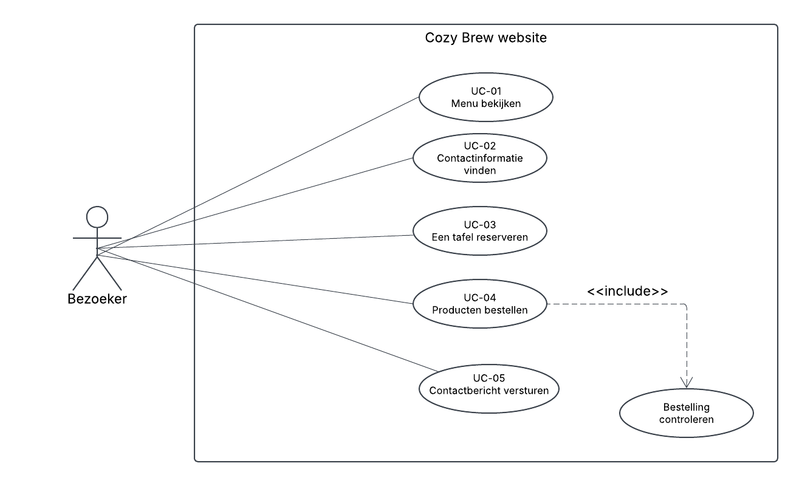

# Ondernemingsplan en Informatieplan

## 1. Probleem en projectdoel

Klanten die bij Cozy Brew langskomen, weten vooraf niet of er een plek vrij is en staan bij drukte lang in de rij om te kunnen bestellen. Wie een vraag heeft over een product, moet die in de zaak stellen of wacht lang op een antwoord per e-mail. Daarnaast kan het menu regelmatig veranderen. Daardoor raakt de informatie online snel verouderd en staan er soms producten op de website die in de zaak niet meer verkrijgbaar zijn. 

De website is bedoeld voor mensen met een druk leven, zoals (deeltijd)studenten en werkenden. In hoofdstuk 2 is deze doelgroep uitgewerkt in de persona's Erik en Sophie.

Via de website kan de klant vooraf het actuele menu met prijzen bekijken, een tafel reserveren en een bestelling samenstellen en controleren. Vragen kan de klant stellen via een contactformulier. Daarnaast komt er een AI-chatbot die vragen direct kan beantwoorden, bijvoorbeeld over allergieen. De chatbot haalt zijn informatie uit hetzelfde menubestand, zodat de antwoorden altijd aansluiten op het actuele menu. Het menu wordt geladen uit een JSON-bestand(`code/json/menu-groep.json`). Zo kan de beheerder producten en prijzen aanpassen zonder de HTML-pagina's te wijzigen, en blijft het menu actueel. 

Binnen het project vallen het ontwerp, de navigatie en de pagina's van de website, met de functies uit het use-case-overzicht in hoofdstuk 9: Menu bekijken, contactinformatie vinden, een tafel reserveren, producten bestellen en een contactbericht versturen. De formulieren controleren de invoer en tonen een bevestiging. Buiten het project valt de back-end: bestellingen, reserveringen en contactberichten worden nog niet opgeslagen of verstuurd, omdat dit pas later in het jaar aan bod komt.

## 2. Doelgroep en persona

De doelgroep van Cozy Brew bestaat uit mensen met een druk leven, zoals (deeltijd)studenten en werkenden met een veeleisende baan. Ze willen vooraf snel zien wat Cozy Brew te bieden heeft en zonder gedoe hun koffie kunnen bestellen of een plek kunnen reserveren. Kwaliteit, duurzaamheid en een gezellige plek om even tot rust te komen vinden ze belangrijk.

### 2.1 Persona 1: Erik Pieterson
 
**Naam en rol:** Erik Pieterson, bezoeker van de website die zijn bestelling wil afhalen.  
**Situatie:** Erik is 28 jaar en volgt naast zijn fulltime baan een deeltijdopleiding aan Avans Hogeschool in Breda. Hij heeft een partner en een hond. Net voordat zijn les begint, kijkt Erik op de website van Cozy Brew of hij nog snel koffie kan halen.  
**Doel:** Vóór zijn les snel koffie bestellen, zodat die klaarstaat als hij bij Cozy Brew aankomt.  
**Belangrijkste behoefte:** Eenvoud. In zijn drukke leven wil Erik zonder zoeken bij de juiste informatie komen. Een duidelijke en overzichtelijke lay-out helpt hem daarbij: hij wil binnen 2 klikken of tikken in het menu zijn.  
**Mogelijke belemmering:** De website geeft na het bestellen geen bevestiging. Erik weet dan niet of zijn bestelling is gelukt en plaatst misschien twee keer dezelfde bestelling. Een volgende keer bestelt hij liever via een andere website, waar hij wel een bevestiging krijgt.  
**Wat de website eenvoudig moet maken:** Een bestelformulier (`bestelling.html`) waarin hij zijn bestelling en eventuele wensen of opmerkingen kan doorgeven, en daarna direct een bevestiging ziet.  
**Ontwerpkeuze:** Op elke pagina staat in de navigatie de link "Bestelling plaatsen" naar `bestelling.html`, zodat Erik vanaf elke pagina direct naar de bestelpagina kan.

### 2.2 Persona 2: Sophie van Dijk

**Naam en rol:** Sophie van Dijk, bezoeker van de website die vooraf het menu bekijkt.  
**Situatie:** Sophie is 31 jaar, woont samen en werkt 32 tot 40 uur per week als marketingmedewerker bij een communicatiebureau in de Randstad. Ze begint haar werkdag graag met een kop koffie, werkt af en toe een uurtje in een koffiezaak of spreekt er af met vrienden. Kwaliteit, duurzaamheid en een gastvrije sfeer vindt ze belangrijk, en daar betaalt ze graag iets meer voor.  
**Doel:** Vooraf het menu bekijken om te zien welke koffie Cozy Brew heeft, wat het kost en of er plantaardige melk is.  
**Belangrijkste behoefte:** Duidelijke en eerlijke informatie: wat er op het menu staat, wat het kost, waar de bonen vandaan komen en of er wifi en stopcontacten zijn als ze wil blijven werken.  
**Mogelijke belemmering:** Informatie die ontbreekt of niet klopt, zoals een product dat online staat maar in de zaak niet te krijgen is. Dan kiest ze voor een andere koffiezaak.  
**Wat de website eenvoudig moet maken:** Op de menupagina (`menu.html`) in één oogopslag zien welke dranken er zijn, met prijzen en opties zoals plantaardige melk, en in de footer de openingstijden en of er wifi is.  
**Ontwerpkeuze:** Bij elk product op het menu staan de prijs en de opties (zoals plantaardige melk), en duurzame keuzes krijgen een herkenbaar icoon.

## 3. Productidentiteit en moodboard

Drie woorden: Rustig, Betrouwbaar, Modern

Toelichting     

Rustig: Zachte kleuren, veel witruimte en een eenvoudige lay-out.

Betrouwbaar: Strakke typografie, consistente iconen en duidelijke structuur.

Modern: Ronde vormen, subtiele schaduwen en een frisse accentkleur.

Het moodboard staat in: docs/ontwerp/week03-moodboard.png.

## 4. Informatieplan

Informatie 1: Dienstenoverzicht	
Voor wie: Bezoeker
Bron: Opdrachtgever
Waar gebruikt?: Home Pagina		
Wie houdt dit bij?: Opdrachtgever 
Informatie 2: Contact gegevens
Voor wie: Bezoeker
Bron: Opdrachtgever
Waar gebruikt?: Contact Pagina + Footer
Wie houdt dit bij?: Opdrachtgever
Informatie 3:Openingstijden
Voor wie: Bezoeker
Bron: Opdrachtgever
Waar gebruikt?: Contact Pagina
Wie houdt dit bij?: Eigenaar van de website
Informatie 4: Introductie tekst
Voor wie: Bezoeker
Bron: Opdrachtgever
Waar gebruikt?: Home Pagina
Wie houdt dit bij?: Team
			
				
				
## 5. Huidige en gewenste werkwijze

### 5.1 Huidige werkwijze (contact opnemen)

-Bezoeker zoekt contactgegevens op verschillende pagina’s.
-Contactgegevens staan soms in een document.
-Bezoeker moet scrollen om het juiste onderdeel te vinden.
-Bezoeker belt of mailt, maar mist soms belangrijke informatie.

### 5.2 Gewenste werkwijze via de website

-Contactgegevens staan altijd zichtbaar in de footer en de contact paginas.
-De contactpaginas tonen telefoonnummer, e-mail en openingstijden in een aparte blad.
-De website verwerkt geen gegevens, maar toont alle benodigde informatie duidelijk.
-De bezoeker hoeft niet te zoeken: alles staat op één plek.

## 6. Eerste eisen en acceptatiecriteria

### 6.1 Eis: De bezoeker kan vanaf iedere pagina naar de homepagina
- Waarom nodig?: Om eenvoudig terug te keren.
- Acceptatiecriterium: Iedere pagina bevat een werkende link naar index.html.

### 6.2 Eis: De navigatie is op desktop en mobiel duidelijk zichtbaar.
-Waarom nodig: Toegankelijkheid.
-Acceptatiecriterium: Menu werkt op 320px t/m 1920px schermbreedte.

### 6.3 Eis: Contactgegevens zijn altijd vindbaar.
-Waarom nodig: Minder zoekwerk.
-Acceptatiecriteria: Minder zoekwerk.	Footer bevat telefoonnummer en e-mail op alle pagina’s.

### 6.4 Eis: De website laadt binnen 3 seconden.
-Waarom nodig: Gebruiksvriendelijkheid.
-Acceptatiecriteria: Lighthouse-test toont laadtijd ≤ 3s.

## 7. Start testoverzicht

Het testoverzicht staat in docs/testing/deel1-testoverzicht.md.

## 8. Globale planning

**Rolverdeling:**
  - Matthieu, Teamleider / coordinator
  - Mitchell, GitHub-beheerder
  - Debora, Ontwerper / UX-coordinator
  - Yannick, Developer / technische lead
  - Koen, Developer / technische lead
  - Cheyenne, Reflectie- en documentatiebeheer 

### 8.1 Week 3–4: Basisstructuur website, moodboard, wireframes, ondernemingsplan

| Onderdeel | Wie | Wat |
|---|---|---|
| Projectstructuur | Yannick | Mappenstructuur volgens de projecteisen opgezet (`docs/ontwerp`, `docs/project`, `docs/testing`, `docs/uml`) |
| Basisstructuur website | Debora | Pagina's contact, openingstijden en bestellingen gemaakt, inclusief bestelformulier met JavaScript; kleuren en lettertype vastgelegd |
| Basisstructuur website | Koen | Pagina "Werken bij" gemaakt, navigatie opgemaakt en logo gekoppeld aan de homepagina |
| Basisstructuur website | Matthieu | Menukaart en contactpagina uitgewerkt; rekentool in JavaScript gebouwd |
| Basisstructuur website | Cheyenne | Eigen opzet van de site gemaakt met menu-, drinks-, food-, bestel- en over-ons-pagina |
| Interactie (JavaScript) | Mitchell | Dropdown en tekst tonen/verbergen gebouwd |
| Moodboard | Koen | Gemaakt; geüpload door Yannick |
| Wireframes | Debora | Wireframes voor de homepagina en de menupagina gemaakt; geüpload door Yannick |
| Ondernemingsplan en informatieplan | Hele team | Samen opgesteld in les 3; uitgewerkt en geüpload door Yannick |
| GitHub-beheer | Mitchell | Pull request #1 (branch Koen) gemerged naar main; oude persona-bestanden opgeruimd |

- Controle: review door Matthieu en commit.

### 8.2 Week 5–7: Pagina's vullen, responsive menu's, JS, navigatie afronden

| Onderdeel | Wie | Wat |
|---|---|---|
| Bestelformulier | Debora | Winkelwagen met verwijderen en totaalberekening, validatie, controleoverzicht en resetfunctie gebouwd (branch `debora/next-gen`) |
| Responsive design | Debora | Layout verbeterd voor mobiel (footer en bestelformulier), CSS opgeschoond; responsive layouts getest en vastgelegd in `docs/testing` |
| Menu (JavaScript) | Debora | Dynamische koffielijst op de menupagina met JavaScript |
| UML | Debora | Activiteitendiagram van de bestelvalidatie en sequentiediagram van de Fetch API gemaakt |
| Menu en producten | Koen | Productkaarten met mediaquery, 9 productfoto's toegevoegd; menu opgehaald uit `menu.json` met fetch, inclusief laad-, lege en foutstatus |
| Interactie (JavaScript) | Koen | Darkmode-knop met eventlistener en responsive openingstijden-checker gebouwd |
| Bestelformulier | Koen | Bestelformulier van Debora overgezet naar de gezamenlijke site en opgenomen in de navigatie |
| Toegankelijkheid | Yannick | Accessibility-knop op alle pagina's, keuze onthouden met localStorage |
| Menu (JavaScript) | Yannick | Menu ophalen met `fetch()`, met foutafhandeling via `console.error` |
| Persona's | Mitchell | Persona 1 en 2 toegevoegd |
| Menu-data | Cheyenne | `menu-groep.json` aangemaakt en eigen opzet van de site bijgewerkt (branch `cheyenne`) |
| GitHub-beheer | Mitchell, Koen | Pull requests #2 en #4 (Mitchell) en #3 (Koen) gemerged naar main |

- Controle: Test-overzicht bijwerken.

### 8.3 Week 8–10: Verbeteringen, responsive design, eerste use-cases

| Onderdeel | Wie | Wat |
|---|---|---|
| Bestelformulier | Koen | Bestelformulier gestyled in Cozy Brew-stijl, inclusief darkmode en mobiel; productkaarten uitgelijnd en prijzen in euro-notatie |
| Darkmode | Koen | Darkmode-keuze onthouden met localStorage |
| Reserveren | Koen | Reserveringspagina met formulier: datum vanaf vandaag, tijden per openingsdag, gesloten dagen, controles, bevestiging en reset |
| Werken bij en openingstijden | Matthieu | Pagina "Werken bij" gevuld; open/gesloten-melding toegevoegd aan alle pagina's |
| Contactpagina | Yannick | Structuur, styling en knopgedrag van het contactformulier |
| Opruimen code | Yannick | Mappenstructuur gerepareerd, afbeeldingslinks hersteld (#36), `innerHTML` vervangen door `textContent` in `bestellen.js` (#12) |
| Homepagina | Debora | Slideshow met negen foto's op de homepagina (#55) |
| Bestelformulier | Debora | Winkelmandje met bewerkbare aantallen, responsive layout en verbeterde validatie (branch `debora/next-gen`) |
| Menu-data | Mitchell | Menu werkend gemaakt met JSON |
| Semantiek | Koen | `<main>` toegevoegd aan menu- en over-ons-pagina (#38) |
| Functioneel ontwerp | Debora | Functioneel ontwerp voor Cozy Brew uitgeschreven (branch `debora/next-gen`) |
| Functioneel ontwerp | Yannick | FO, wireframes, testoverzichten en UML samengebracht in `docs/`; FR-08 en UC-05 (contactformulier) toegevoegd |
| Technisch ontwerp | Koen, Yannick | Koen: opzet, inleiding, bestandsstructuur, API-verwerking en gebruikte technieken (#35); Yannick: localStorage in 3.1, 3.2 en 5.2 |
| UML | Koen | Use-case diagram opnieuw getekend voor Cozy Brew met UC-nummers (#16); sequentiediagram week 7 opnieuw getekend (#17) |
| Ondernemingsplan | Koen | Hoofdstuk 1, 2 en 9 aangepast aan Cozy Brew, opmaak gelijkgetrokken, persona's verplaatst naar hoofdstuk 2 (#22) |
| Hulpmiddel | Koen | Script `md-naar-pdf` gemaakt om markdown naar pdf in Cozy Brew-stijl om te zetten (branch `Koen`) |
| AI-terugblik | Koen, Yannick | Terugblik op AI-gebruik in week 10 geschreven |
| GitHub-beheer | Mitchell, Yannick, Matthieu | Mitchell: PR #5–#9, #11 en #41 gemerged en oude mappen opgeruimd; Yannick: PR #10, #42, #43 en #45; Matthieu: PR #40 en #47 |

- Controle: Eindcontrole + commit.

## 9. Eerste use-case-overzicht

**Rol:** Bezoeker

**Doelen:**

- UC-01 Menu bekijken
- UC-02 Contactinformatie vinden
- UC-03 Een tafel reserveren
- UC-04 Producten bestellen
  - `<<include>>` Bestelling controleren
- UC-05 Contactbericht versturen

In week 3 bevatte dit overzicht drie algemene doelen. Na de feedback in week 9 is het diagram opnieuw getekend voor Cozy Brew en uitgebreid naar vijf use-cases, zodat het aansluit op de use-cases in het functioneel ontwerp [(#16)](https://github.com/Deb-Summer-Beam/Koffiezaak/issues/16).

**Diagram opgeslagen als:**

- 
- [Bewerkbaar bestand (.vsdx)](../uml/week03-usecase-start.vsdx)

Volgens de les mag elke tool gebruikt worden. Daarom is `.vsdx` gebruikt in plaats van `.drawio`.

## 10. Controle en vastleggen

Plan sluit aan op projectbeschrijving en wireframes.

Doelgroep, persona en productidentiteit passen bij elkaar.

Informatie heeft duidelijke bron en toepassing.

Werkwijze is helder beschreven.

Eisen hebben controleerbare acceptatiecriteria.

Testoverzicht bevat uitgevoerde tests.

Planning is haalbaar.

Use-case-overzicht bevat rol en doelen.

Verwijzingen naar bestanden werken.

Alles is gecommit en gepusht naar de teamrepository.