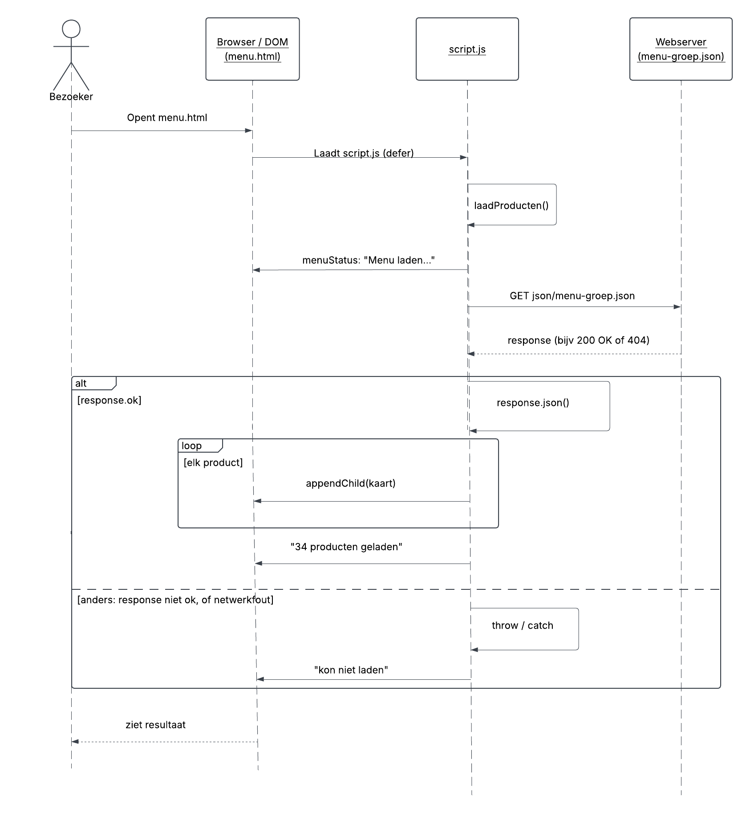

# Cozy Brew - Technisch Ontwerp

## 1. Inleiding

Dit technisch ontwerp (TO) beschrijft hoe de Cozy Brew-website is opgebouwd. Waar het [functioneel ontwerp](../ontwerp/functioneel-ontwerp.md) beschrijft wat de bezoeker op de website kan doen, legt dit document uit hoe dat gerealiseerd is: welke technieken we gebruiken, hoe de bestanden zijn opgebouwd, welke functies en gegevens de belangrijkste onderdelen vormen en hoe de website gegevens ophaalt en verwerkt. 

Het document is bedoeld voor ontwikkelaars die aan de website verder werken of hem willen nabouwen. Het TO groeit mee met het project: bij een technische wijziging wordt het bijgewerkt. Waar mogelijk verwijzen we naar bestaande bestanden, diagrammen en testverslagen, in plaats van dezelfde inhoud opnieuw te tonen in dit bestand. 


## 2. Technieken en bestandsstructuur
### 2.1 Gebruikte technieken
### 2.2 Bestandsstructuur
```
Koffiezaak/
├── code/
│   ├── index.html
│   ├── menu.html
│   ├── about_us.html
│   ├── bestelling.html
│   ├── reservering.html
│   ├── contact.html
│   ├── werkenbij.html
│   ├── css/
│   │   └── style.css
│   ├── javascript/
│   │   ├── script.js        (alle pagina's)
│   │   ├── bestellen.js     (alleen bestelling.html)
│   │   └── reserveren.js    (alleen reservering.html)
│   └── json/
│       └── menu-groep.json
├── images/
│   └── Producten/
├── design/
│   └── wireframes/
└── docs/
    ├── ontwerp/
    ├── project/
    │   └── persona/
    ├── technisch/
    ├── testing/
    └── uml/
```

HTML, CSS, JavaScript en JSON hebben elk een eigen map. Zo is de structuur (HTML), de opmaak (CSS), het gedrag (JavaScript) en de data (JSON) van elkaar gescheiden. Dit maakt het makkelijker om met meerdere mensen tegelijk aan het project te werken en verkleint de kans op mergeconflicten: de ene developer werkt bijvoorbeeld aan de opmaak in de CSS, terwijl een ander in JavaScript werkt. Ook blijft de code leesbaar: naarmate het project groeit, wordt het steeds lastiger om een fout te vinden als alles door elkaar staat.

Afbeeldingen en code houden we ook gescheiden. Foto’s zijn statische bestanden die niet veranderen, terwijl de code steeds wordt aangepast. Door alle afbeeldingen in één map images/ te zetten, staan ze overzichtelijk bij elkaar in plaats van verspreid tussen de code. Omdat de HTML-pagina’s in code/ staan, verwijzen ze naar de afbeeldingen met het pad ../images/.

### 2.3 Samenwerking tussen HTML, CSS en JavaScript


## 3. Functies, gegevens en herbruikbare onderdelen
### 3.1 Gegevens (datamodel)
### 3.2 Belangrijkste functies
### 3.3 Herbruikbare onderdelen

## 4. API-verwerking
### 4.1 Gegevensbron
Het bestand dat we ophalen is code/json/menu-groep.json: een array met 34 objecten. Elk object is een product met de volgende gegevens: naam (string), categorie (string), afbeelding (string), omschrijving (string) en prijs (number). Er is geen API-sleutel en geen limiet nodig, omdat het om een lokaal bestand gaat dat niet wordt opgehaald uit een externe service. De producten staan in een JSON-bestand, zodat data en code gescheiden blijven. Dit houdt de code overzichtelijker.

### 4.2 Verwerking
De JSON wordt opgehaald met de functie async function `laadProducten()` in `script.js`. Dit script staat op alle pagina’s en roept `laadProducten()` direct aan bij het laden van de pagina. De functie zoekt eerst met querySelector naar .productenoverzicht en #menuStatus. Worden die niet gevonden, dan stopt de functie meteen met return. Daardoor wordt het menu alleen op menu.html opgehaald. Tijdens het laden ziet de bezoeker de melding “Menu laden...”. Daarna zet `response.json()` het antwoord om naar een array met product-objecten. Een forEach loopt elk product langs en roept `maakProductKaart(product)` aan. Deze functie bouwt per product een `<article>` met een foto, een h2, een omschrijving, de prijs (met `toLocaleString` omgezet naar euro’s) en de knop “In winkelwagen”. Daarna zet appendChild de kaart in .productenoverzicht. Alle tekst wordt met textContent geplaatst, zodat de inhoud van de JSON nooit als HTML wordt uitgevoerd. Tot slot toont de status het aantal geladen producten met producten.length + " producten geladen".

### 4.3 Foutafhandeling
Het ophalen van het menu kan op drie manieren misgaan. Alle drie de fouten komen terecht in hetzelfde catch-blok. 

1. De server stuurt een foutcode. Als het bestand niet gevonden wordt (bijvoorbeeld een 404), is `response.ok` false. De code gooit dan zelf een fout met `throw new Error("Menu laden mislukt: " + response.status)`, waardoor de uitvoering naar `catch` springt.

2. Netwerkfout. Als er geen verbinding is of de server niet reageert, krijgt de `fetch()` helemaal geen antwoord terug. De fetch mislukt dan zelf en springt direct naar de `catch`. De controle op `response.ok` wordt in dat geval overgeslagen.

3. Ongeldige JSON. Als het JSON-bestand een fout bevat, bijvoorbeeld een ontbrekende komma of een aanhalingsteken, kan `response.json()` het antwoord niet omzetten naar een array. Ook dan ontstaat er een fout die naar de `catch` springt. 

In de `catch` gebeuren twee dingen, voor twee verschillende doelgroepen. Met `console.error(error)` wordt de technische fout in de console geschreven, zodat een ontwikkelaar kan zien wat er misging. De bezoeker krijgt in `#menuStatus` de melding "Het menu kon niet worden geladen.", in plaats van een lege pagina zonder uitleg. Omdat `#menuStatus` het attribuut `aria-live="polite"` heeft, leest een schermlezer deze melding ook voor. De bezoeker weet dan dat het laden mislukt is. 

### 4.4 Sequence-diagram


Het diagram toont het verzoek van `script.js` aan de webserver, het antwoord, en de twee routes daarna: het laden van de productkaarten bij een geslaagd antwoord, en de foutmelding bij een mislukte poging.


## 5. Technische keuzes
### 5.1 Responsiviteit
### 5.2 Toegankelijkheid
### 5.3 Veilig omgaan met gegevens

## 6. Testaanpak en bekende beperkingen