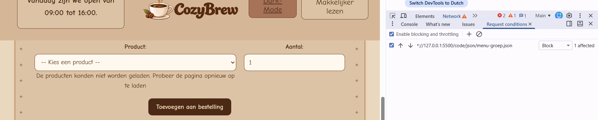
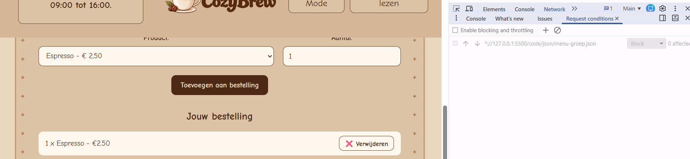
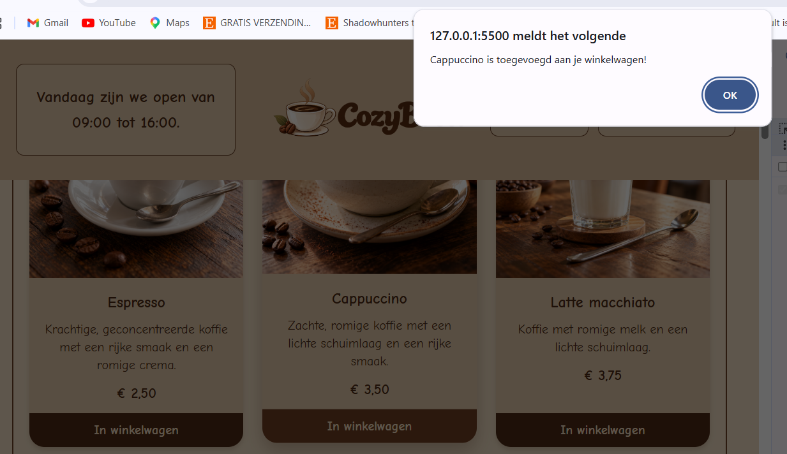
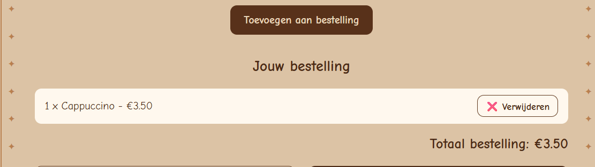
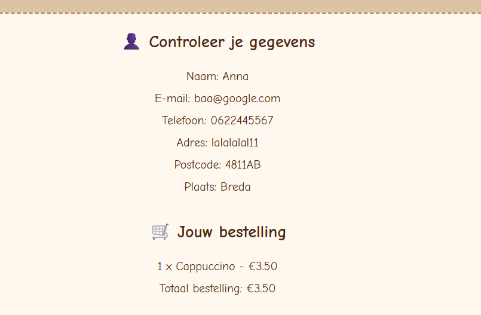
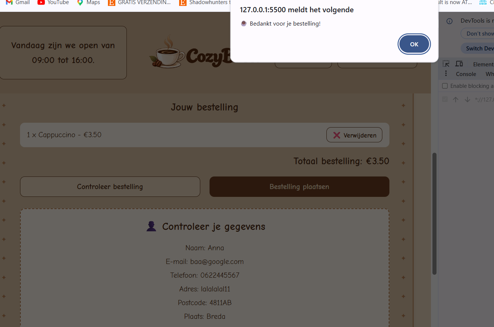
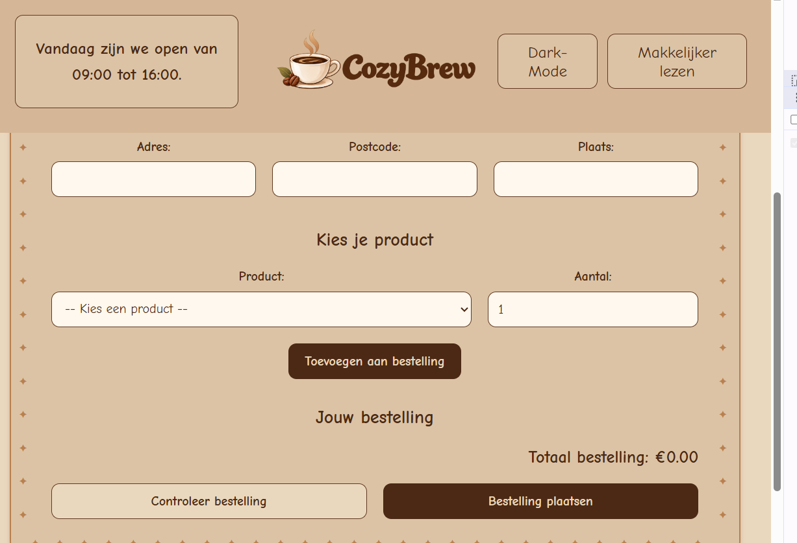

# Testverslag – Issue #52: Centrale productgegevens

## 1. Projectgegevens

- Project: Cozy Brew
- Issue: #52
- Branch: feature/52-centrale-productgegevens
- Uitvoering: Debora Rodriguez Montaldo
- Testomgeving: VS Code, Live Server en Google Chrome
- Testmethode: Handmatige functionele tests en regressietests

## 2. Doel van de opdracht

Het doel van Issue #52 is om de producten en prijzen
vanuit één centrale gegevensbron te beheren:
`menu-groep.json`.

Hierdoor wordt voorkomen dat producten en prijzen
op meerdere plaatsen worden bijgehouden en onderling
van elkaar kunnen afwijken.

Dit principe wordt Single Source of Truth (SSOT) genoemd.

Daarnaast moet de klant een begrijpelijke foutmelding
krijgen wanneer de productgegevens niet geladen
kunnen worden.

## 3. Uitgevoerde wijzigingen

### 3.1 JavaScript – bestellen.js

- Het oude object `const prijzen` met 19 hardcoded
  productprijzen is verwijderd.
- Vooraf is met Git gecontroleerd of het oude
  prijzenobject nog ergens werd gebruikt.
- De bestaande fetch-functionaliteit is behouden.
- Producten en prijzen worden opgehaald uit
  `menu-groep.json`.
- De bestaande functie `berekenTotaal()` is behouden.
- Het commentaar bij `winkelwagenWordtGeladen`
  is verduidelijkt.
- Een zichtbare foutmelding is toegevoegd aan
  het catch-blok.
- De technische foutmelding in de console is behouden.
- De foutmelding wordt veilig weergegeven met
  `textContent`.

### 3.2 HTML – bestelling.html

- De 19 hardcoded producten en prijzen zijn verwijderd.
- De drie oude optgroup-elementen zijn verwijderd.
- Het select-element en de standaardoptie zijn behouden.
- De productkeuzelijst wordt dynamisch gevuld
  vanuit JavaScript.
- Een span-element met id `product-fout` is toegevoegd.
- De bestaande CSS-klasse `foutmelding` wordt hergebruikt.
- Het attribuut `role="alert"` ondersteunt
  de toegankelijkheid van de foutmelding.

### 3.3 JSON – menu-groep.json

Het bestaande JSON-bestand bevat 34 producten
met bijbehorende productgegevens en prijzen.

Dit bestand blijft de centrale gegevensbron.

Het JSON-bestand is voor deze opdracht niet aangepast.

## 4. Uitgevoerde tests

### Test 1 – Productkeuzelijst na JavaScript-wijziging

- Actie: De bestelpagina openen na het verwijderen
  van het oude prijzenobject.
- Verwacht resultaat: Alle producten en prijzen
  blijven beschikbaar.
- Werkelijk resultaat: Alle producten zijn zichtbaar.
- Status: GESLAAGD.

### Test 2 – Eén product toevoegen

- Actie: Twee cappuccino's toevoegen.
- Prijs per product: €3,50.
- Verwacht resultaat: €7,00.
- Werkelijk resultaat: €7,00.
- Status: GESLAAGD.

### Test 3 – Meerdere producten toevoegen

- Actie: Drie espresso's toevoegen aan de bestelling
  met twee cappuccino's.
- Cappuccino's: €7,00.
- Espresso's: €7,50.
- Verwacht totaalbedrag: €14,50.
- Werkelijk totaalbedrag: €14,50.
- Status: GESLAAGD.

### Test 4 – Product verwijderen

- Actie: De drie espresso's verwijderen.
- Verwacht resultaat: Alleen de twee cappuccino's
  blijven in het winkelmandje staan.
- Verwacht totaalbedrag: €7,00.
- Werkelijk resultaat: Het winkelmandje en het
  totaalbedrag worden correct bijgewerkt.
- Status: GESLAAGD.

### Test 5 – Dynamische productkeuzelijst

- Actie: De oude productlijst uit de HTML verwijderen
  en de bestelpagina opnieuw laden.
- Verwacht resultaat: Alle 34 producten worden
  dynamisch geladen vanuit JSON.
- Werkelijk resultaat: Alle 34 producten zijn
  handmatig geteld en gecontroleerd.
- Status: GESLAAGD.

### Test 6 – Extra producten uit JSON

- Actie: Twee verschillende producten bestellen
  die niet in de oorspronkelijke lijst stonden.
- Verwacht resultaat: De producten worden toegevoegd
  en het totaalbedrag wordt correct berekend.
- Werkelijk resultaat: De toevoeging en prijsberekening
  werken volgens de handmatige controle correct.
- Status: GESLAAGD.

### Test 7 – Foutafhandeling bij JSON-laadfout

- Actie: Het netwerkverzoek naar `menu-groep.json`
  tijdelijk blokkeren via Chrome DevTools.
- Verwacht resultaat: De klant krijgt een begrijpelijke
  foutmelding en de productkeuzelijst blijft leeg,
  met uitzondering van de standaardoptie.
- Werkelijk resultaat: De foutmelding verschijnt
  onder de productkeuzelijst.
- Status: GESLAAGD.

**Testbewijs:**

### Test 8 – Herstel na JSON-laadfout

- Actie: De netwerkblokkering uitschakelen en
  de bestelpagina opnieuw laden.
- Verwacht resultaat: De producten worden opnieuw
  geladen en de foutmelding verdwijnt.
- Werkelijk resultaat: De producten zijn opnieuw
  beschikbaar en de foutmelding is verdwenen.
  Het eerder opgeslagen product wordt hersteld.
- Status: GESLAAGD.

**Testbewijs:**

### Test 9 – Bestellen vanuit de menukaart

- Actie: Op In winkelwagen klikken bij Cappuccino
  op de menukaart.
- Verwacht resultaat: Een zichtbare bevestiging,
  gevolgd door de bestelpagina met het gekozen product.
- Werkelijk resultaat: De bevestiging verschijnt
  en na het sluiten van de melding wordt de
  bestelpagina geopend.
- Product: 1 cappuccino.
- Totaalbedrag: €3,50.
- Status: GESLAAGD.

**Testbewijs:**

### Test 10 – Controleoverzicht

- Actie: Klantgegevens invullen en op
  Controleer bestelling klikken.
- Verwacht resultaat: De klantgegevens, producten,
  aantallen en het totaalbedrag worden weergegeven.
- Werkelijk resultaat: Het controleoverzicht toont
  de ingevulde gegevens en de juiste bestelling.
- Totaalbedrag: €3,50.
- Status: GESLAAGD.

**Testbewijs:**

### Test 11 – Bestelling plaatsen en resetten

- Actie: Op Bestelling plaatsen klikken.
- Verwacht resultaat: Een bedankmelding verschijnt.
  Na het sluiten van de melding wordt de bestelling
  gereset.
- Werkelijk resultaat: De bedankmelding verschijnt,
  het winkelmandje wordt leeggemaakt en het
  controleoverzicht verdwijnt.
- Totaalbedrag na reset: €0,00.
- Productkeuzelijst: Standaardoptie.
- Aantal na reset: 1.
- Status: GESLAAGD.

**Testbewijs:**

### Test 12 – Winkelmandje na vernieuwen

- Actie: De bestelpagina na het plaatsen van
  de bestelling vernieuwen met Ctrl + R.
- Verwacht resultaat: De vorige bestelling wordt
  niet opnieuw ingeladen.
- Werkelijk resultaat: Het winkelmandje blijft leeg.
- Status: GESLAAGD.

## 5. Overzicht testresultaten

| Test | Omschrijving | Resultaat |
| --- | --- | --- |
| 1 | Productkeuzelijst na JavaScript-wijziging | Geslaagd |
| 2 | Eén product toevoegen | Geslaagd |
| 3 | Meerdere producten toevoegen | Geslaagd |
| 4 | Product verwijderen | Geslaagd |
| 5 | Dynamische productkeuzelijst | Geslaagd |
| 6 | Extra producten uit JSON | Geslaagd |
| 7 | JSON-laadfout | Geslaagd |
| 8 | Herstel na JSON-laadfout | Geslaagd |
| 9 | Bestellen vanuit de menukaart | Geslaagd |
| 10 | Controleoverzicht | Geslaagd |
| 11 | Bestelling plaatsen en resetten | Geslaagd |
| 12 | Winkelmandje na vernieuwen | Geslaagd |

- Uitgevoerde tests: 12
- Geslaagde tests: 12
- Mislukte tests: 0
- Screenshots als testbewijs: 7

## 6. Kwaliteit en onderhoudbaarheid

De dubbele productgegevens zijn verwijderd uit
JavaScript en HTML.

Hierdoor hoeven toekomstige wijzigingen aan producten
en prijzen alleen in het centrale JSON-bestand
te worden bijgehouden.

De oplossing draagt bij aan:

- Betere onderhoudbaarheid.
- Consistente productprijzen.
- Minder dubbele code.
- Minder risico op afwijkende productgegevens.
- Begrijpelijke foutafhandeling.
- Toegankelijkheid.
- Veilige DOM-manipulatie met textContent.

## 7. Conclusie

De productgegevens en prijzen worden vanuit één
centrale JSON-bron opgehaald.

De oude hardcoded productgegevens zijn verwijderd
uit bestellen.js en bestelling.html.

De uitgevoerde functionele tests en regressietests
tonen aan dat de geteste bestelfunctionaliteiten
behouden zijn gebleven.

Ook de foutafhandeling en het herstel na een
JSON-laadfout zijn succesvol getest.

Alle twaalf uitgevoerde tests zijn geslaagd.

De wijzigingen zijn gereed voor verdere controle
en review.